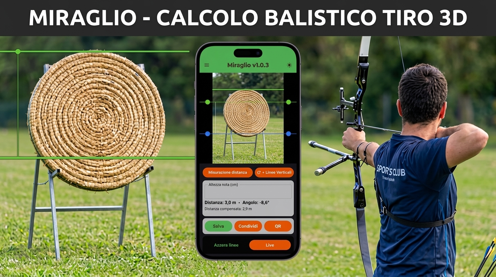

# Miraglio



**Miraglio** è un'app Android per arcieri che **stima la distanza del bersaglio con la
fotocamera del telefono** (modello pinhole + calibrazione focale), permette di
**verificare la misura camminando con il GPS** e di **salvare i luoghi** (foto +
misura + coordinate), condivisibili come pin Google Maps, QR code o foto georeferenziata.

> **📲 Installare l'app sul telefono** (guida per chi la usa, non per chi la sviluppa):
> [INSTALLAZIONE.md](INSTALLAZIONE.md) — download dalla release, conferma di Android,
> prima calibrazione. Dalla prossima release lo stesso testo è pubblicato anche
> nelle note di rilascio.
>
> **📖 Manuale d'uso (italiano):** [MANUALE.md](MANUALE.md) — calibrazione per il massimo
> della precisione, limiti per dispositivo, zoom e modalità d'uso.

---

## Funzionalità

### Misura con la fotocamera (modalità LINEE — è la schermata iniziale)
- **Pizzica per zoomare** sul bersaglio, premi **Scatta fermo immagine**
- **Due linee** (verde/blu) sui bordi del bersaglio: tap per riselezionare,
  striscia a **sinistra** per spostarle, a **destra** per allargarle/stringerle;
  la distanza si ricalcola in tempo reale
- **Altezza nota libera in cm** (nessun preset); lo **zoom compensa** la focale
  automaticamente
- Linee **orizzontali** = altezza (fy), **verticali** = larghezza (fx), con
  bottone per scambiare l'asse
- Modalità **ALTEZZA**: da distanza nota calcola la dimensione reale tra le linee
- **Inclinometro**: la distanza orizzontale è compensata con l'angolo di tiro (cos θ)

### Riconoscimento bersagli (opzionale, YOLOv8n ONNX)
- Modello **`yolov8n_hybrid.onnx`** inclusa in `app/src/main/assets/models/`
- Classi: **paglione** (bersaglio circolare, default 130 cm) e **Targa 3D**
  (rettangolare, default 80 cm) con preset di dimensione
- Allo scatto i bersagli vengono riquadrati in verde e **le linee si agganciano
  da sole** agli estremi del bersaglio più grande
- **Spento di default** (Impostazioni → *Riconoscimento paglione*): il modello
  ONNX è lazy e non viene caricato in memoria se non serve; riconoscimento una
  sola volta al fermo immagine, zero inferenza sull'anteprima

### Verifica distanza (GPS)
- **Partenza → cammina → arrivo**: distanza con Haversine, percorso a piedi
  cumulato, accuratezza dei fix mostrata in tempo reale
- La partenza si blocca **solo su un fix satellitare di adesso** (entro ±10 m,
  confermato dal fix successivo): un fix vecchio o di rete come partenza
  sposterebbe il punto di partenza di decine di metri, inventando distanza
- Si misura solo col **provider satellitare**; i fix scadenti o vecchi non
  entrano né nel percorso né nella chiusura, e "FINO A QUI" resta spento
  finché non torna un fix di adesso
- Il **percorso a piedi** somma ogni spostamento plausibile (rumore da fermo,
  salti e buchi negli aggiornamenti esclusi dalle regole in
  `domain/location/MeasurementRules.kt`, coperte da test)
- **Errore stimato** (accuratezze dei due fix combinate in quadratura); oltre 5 m
  di incertezza l'app chiede conferma prima di chiudere la misura
- La misura in corso **sopravvive alla morte del processo** (se non è più
  recente di 15 minuti) e il GPS resta attivo in background per **10 minuti**,
  il tempo di raggiungere il punto finale

### Calibrazione focale
- Focale **teorica** (FOV diagonale 67°) finché non si calibra: utile come prima
  prova, può sbagliare anche del 30%
- **Calibrazione multipunto per lente**: fotografa un bersaglio di dimensione e
  distanza note, posiziona le linee H/V con la lente d'ingrandimento → fx/fy come
  media dei punti
- **Ogni obiettivo** (1x, ultra-grandangolo, tele…) ha la **propria calibrazione**;
  una lente non calibrata ripiega sulla lente principale
- Le misure usano la focale calibrata **automaticamente**, zoom compreso

### Luoghi e condivisione
- **Salva** lo scatto (foto + misura + GPS + bersaglio stimato dalla bussola) o la
  misura GPS a piedi
- Elenco luoghi con **riepilogo, rinomina, eliminazione** e dettaglio completo
- **Condivisione**: messaggio di testo con pin Google Maps (`https://maps.google.com/?q=lat,lon`,
  tappabile da Android e iPhone), **QR code** del link o del messaggio (ZXing),
  foto con banda di testo e **GPS nei metadati EXIF**
- Archivio **interamente offline**: foto JPEG + indice `index.json` nei file
  interni dell'app, nessun database e nessun server

### Sensori e consumi
- **Bussola**: direzione di mira in gradi dal nord vero, con etichetta N/NE/E/…
- **Risparmio energetico**: in background sensori e GPS si spengono (tranne la
  finestra di grazia della misura GPS); tutto riparte al rientro in primo piano

### Aggiornamenti dall'app (GitHub Releases)
- **Controllo silenzioso all'avvio** (senza rete non si vede niente) e voce
  **Aggiornamenti** in Impostazioni, con la versione installata e un bottone per
  controllare a mano
- Se c'è una versione più recente compare un dialog con le **note di rilascio**;
  l'APK si scarica **solo quando lo chiedi** e l'**installazione la conferma
  sempre Android** (l'app non installa niente da sola)
- L'APK scaricato è **firmato con la stessa chiave** di quello installato,
  quindi aggiornarsi **non cancella luoghi, foto e calibrazioni**
- Nel dialog dell'app le note sono **solo le novità**: la guida di installazione
  che apre la pagina della release viene tagliata al marcatore
  `<!-- fine-guida-installazione -->` (logica pura in `domain/update/ReleaseNotes.kt`,
  coperta da test)

### Installare Miraglio su un altro telefono
- In *Impostazioni* la card **Installa su un altro telefono** genera il **QR e il
  link della release più recente**: l'altro arciere inquadra il QR, si apre la
  pagina con le istruzioni e l'APK ([INSTALLAZIONE.md](INSTALLAZIONE.md))
- **Condividi** manda il messaggio con il link, **Condividi il QR come immagine**
  manda il QR come foto; il link resta visibile e copiabile nel dialog
- Il link è costruito dal repository degli aggiornamenti (`BuildConfig.UPDATE_REPO`)
  e punta a `/releases/latest`, quindi **non invecchia** con le versioni
- Il confronto fra versioni è **numerico**: `1.0.10` è più recente di `1.0.9`
  (un confronto fra testi direbbe il contrario)

---

## Schermate

L'app si apre sulla schermata di **misura**; dal menu (☰) si raggiungono le altre:

| Schermata | Percorso |
|-----------|----------|
| Misura (LINEE) | iniziale |
| Verifica distanza | menu → *Verifica distanza* |
| Luoghi memorizzati | menu → *Luoghi memorizzati* |
| Dettaglio luogo | da elenco luoghi |
| Calibrazione focale | menu → *Calibrazione* |
| Impostazioni | menu → *Impostazioni* |

---

## Stack tecnico

| Layer | Tecnologia |
|-------|------------|
| UI | Jetpack Compose (Material 3, chiaro/scuro), Navigation Compose, PreviewView (CameraX) |
| DI | Hilt |
| Persistenza | SharedPreferences (calibrazione, impostazioni) + indice JSON dei luoghi + SavedStateHandle |
| Camera | CameraX 1.4 (ImageAnalysis + Preview), lenti multiple, zoom digitale |
| ML / Vision | ONNX Runtime (YOLOv8n), ML Kit Text Recognition |
| QR / Condivisione | ZXing (solo generazione), FileProvider, ExifInterface (GPS) |
| GPS / Sensori | LocationManager (misure solo dal provider satellitare), accelerometro/giroscopio, bussola |
| Formato display | Numeri con virgola decimale e date gg/mm/aaaa, ora di Roma, via `domain/format/ItalianFormat.kt` |
| Build | Gradle (Kotlin DSL), libs.versions.toml, AGP 8.7.3, Kotlin 2.1.0 |
| Min SDK | 26 (Android 8.0) — Target/Compile SDK 35 |
| Aggiornamenti | GitHub Releases REST API (`HttpURLConnection` + `org.json`), FileProvider → installatore di sistema |
| Release / CI | GitHub Actions (tag `v*.*.*` → APK firmato → release pubblicata) |
| Test | JUnit 4 (JVM) sul confronto versioni |

---

## Struttura del progetto

```
app/src/main/java/com/miraglio/
├── data/
│   ├── camera/        # CameraService, MiraglioAnalyzer (fotogramma latest), BitmapConverter
│   ├── focal/         # FocalCalibrationStore (punti fx/fy per lente)
│   ├── location/      # LocationTracker (GPS + network)
│   ├── ocr/           # OcrTextRecognizer (ML Kit) — vedi nota sotto
│   ├── places/        # PlacesRepository (foto + index.json), PlaceRecord
│   ├── sensor/        # Compass, Inclinometer
│   ├── session/       # ShotVerificationStore (stima vs misura)
│   ├── settings/      # AppSettingsStore (riconoscimento on/off)
│   ├── share/         # QrCodeRenderer (ZXing), ShareImageComposer (banda + EXIF GPS)
│   ├── update/        # GitHubReleasesClient, ApkDownloader, ApkInstaller, UpdateManager
│   └── vision/        # YoloObjectDetector (ONNX), NoOpObjectDetector
├── domain/
│   ├── camera/        # PinholeDistanceEstimator (d = K·f/pixel)
│   ├── location/      # GpsFix, Haversine, TargetEstimator (bersaglio stimato)
│   ├── share/         # ShareMessageComposer (messaggi con pin Maps)
│   ├── update/        # AppVersion, ReleaseInfo, ReleaseNotes (taglia la guida), InstallInvite
│   └── vision/        # ObjectDetector, DetectionBox, TargetScorer
├── di/                # Moduli Hilt (VisionModule)
├── power/             # BackgroundPowerController (sensori/GPS in background)
└── ui/
    ├── capture/       # Schermata misura (fermo immagine + linee + gesture)
    ├── measurement/   # Verifica distanza a piedi (GPS)
    ├── calibration/   # Elenco calibrazioni
    ├── focal/         # Scatto punti di calibrazione (linee + lente d'ingrandimento)
    ├── places/        # Elenco + dettaglio luogo, barra Salva/Condividi/QR
    ├── settings/      # Impostazioni
    ├── navigation/    # NavHost (Capture, Measurement, Places, Calibration, …)
    ├── update/        # Dialog di aggiornamento (scaricamento + installazione)
    └── theme/         # Tema Material 3 (verde/arancio, chiaro/scuro)

app/src/main/assets/models/yolov8n_hybrid.onnx   # modello di riconoscimento (~12 MB)
app/src/main/res/drawable-nodpi/                  # icona dell'app (foto PNG, 432 px)
app/src/test/java/com/miraglio/                   # test: aggiornamento, invito, regole di misura
docs/img/                                         # banner, infografica e icona usate nei documenti
.github/workflows/release.yml                    # tag -> APK firmato -> release
```

---

## Stato corrente (v1.0.3, versionCode 4)

| Funzione | Stato |
|----------|-------|
| Misura LINEE (fermo immagine + linee + gesture) | ✅ Funzionante |
| Riconoscimento bersagli YOLOv8n (ONNX incluso) | ✅ Integrato (opt-in, test dispositivo in corso) |
| Calibrazione focale multipunto per lente | ✅ Funzionante |
| Compensazione inclinazione (distanza orizzontale) | ✅ Funzionante |
| Verifica distanza GPS (partenza→arrivo, errore stimato) | ✅ Funzionante |
| Luoghi: salva/elenca/rinomina/elimina | ✅ Funzionante |
| Condivisione: messaggio + pin Maps + QR + foto con EXIF GPS | ✅ Funzionante |
| Aggiornamento dall'app (GitHub Releases) | ⚠️ Integrato, **da provare sul telefono** |
| Invito installazione (QR/link per un altro arciere) | ⚠️ Integrato, **da provare sul telefono** |
| OCR testi (ML Kit) | ⚠️ Integrato ma **non attivo** sul flusso video attuale |
| Test automatici | ✅ Coprono aggiornamento, invito installazione e regole di misura |

Note oneste:
- La precisione senza calibrazione focale può essere peggiore del 30%: la guida
  completa in [MANUALE.md](MANUALE.md) spiega come calibrare.
- I dati di calibrazione valgono solo sul dispositivo che li ha generati.
- La distanza è soggetta al limite di 80 m del modello pinhole implementato.

---

## Compilazione

```bash
# Dalla root del progetto (Gradle arriva dal wrapper, non serve installarlo)
./gradlew assembleDebug     # APK di debug
./gradlew assembleRelease   # APK di release, firmato (quello degli aggiornamenti)
./gradlew check             # test + lint (lint con warningsAsErrors)
```

Output: `app/build/outputs/apk/debug/app-debug.apk` e
`app/build/outputs/apk/release/app-release.apk` (senza `keystore.properties` la
release esce **`app-release-unsigned.apk`**, che non si installa: vedi
*Firma dell'APK*).

### Requisiti
- JDK 17+
- Android SDK 35
- `local.properties` con `sdk.dir` (generato da Android Studio)

---

## Pubblicare una nuova versione

Il tag è la versione: da quella release la vostra app installata si accorge
dell'aggiornamento. Il workflow **rifiuta** la pubblicazione se tag e
`versionName` non coincidono, perché produrrebbe un APK che nessuno vede come
più recente.

Le istruzioni di installazione che finiscono nella release sono
[INSTALLAZIONE.md](INSTALLAZIONE.md): è l'**unica fonte**, quindi si correggono
solo lì (il workflow la usa come corpo delle note, seguito dal changelog
generato da GitHub). Il banner e l'infografica che contiene sono puntati a
`https://raw.githubusercontent.com/oraziog/miraglio/master/docs/img/...` e non
a percorsi relativi: il corpo della release non è un file del repository, e un
link relativo darebbe 404 proprio sulla pagina che deve installare l'app.

1. Alza **`versionCode`** e **`versionName`** in [app/build.gradle.kts](app/build.gradle.kts)
   (es. `versionCode = 4`, `versionName = "1.0.3"`).
2. Committa e spingi il tag:

```bash
git commit -am "Versione 1.0.3"
git tag v1.0.3
git push origin master v1.0.3
```

3. GitHub Actions compila, firma e pubblica la release con l'APK allegato
   ([.github/workflows/release.yml](.github/workflows/release.yml)): si segue
   in *Actions* su GitHub.
4. Al primo avvio dopo la pubblicazione l'app installata avvisa che c'è la 1.0.3.

### Firma dell'APK

La firma è **l'identità dell'app**: Android accetta un aggiornamento solo se è
firmato con la stessa chiave del pacchetto installato, altrimenti prima va
disinstallata l'app (perdendo luoghi, foto e calibrazioni). Per questo la chiave
di rilascio è **dedicata** e custodita **fuori dal repository**, in
`%USERPROFILE%\.miraglio\miraglio-release.jks`. Prima era la chiave di debug
(della macchina di sviluppo, password `android`): chi la possedeva poteva firmare
un APK che il telefono avrebbe accettato come aggiornamento di Miraglio.

| Dove | Cosa |
|------|------|
| `keystore.properties` (radice, in `.gitignore`) | `storeFile`, `storePassword`, `keyAlias`, `keyPassword` — come si firma in locale |
| Segreti del repository | `KEYSTORE_B64` (il `.jks` in base64), `KEYSTORE_PASSWORD`, `KEY_ALIAS`, `KEY_PASSWORD` — il workflow li passa come variabili d'ambiente `KEYSTORE_PATH`, `KEYSTORE_PASSWORD`, `KEY_ALIAS`, `KEY_PASSWORD` |
| Impronta del certificato | `ce7eaa63…34250f73` (SHA-256): il workflow la controlla sull'APK appena compilato e **si ferma** se non combacia |

Password e chiave si copiano in un gestore di password (e il `.jks` anche fuori
dal computer): **se la chiave si perde, nessun telefono può più aggiornarsi**, e
ogni arciere deve disinstallare e reinstallare. L'impronta e la password sono
anche in `%USERPROFILE%\.miraglio\CHIAVE-FIRMA.txt`, da spostare lì.

Senza chiave configurata la release esce **non firmata**
(`app-release-unsigned.apk`): il ripiego sulla chiave di debug è stato tolto
apposta, perché un APK firmato con la chiave sbagliata si scoprirebbe solo al
primo aggiornamento fallito sui telefoni. Su una macchina nuova la chiave si
ricrea così (la password la chiede keytool: va scelta lunga e custodita):

```bash
keytool -genkeypair -keystore "$HOME/.miraglio/miraglio-release.jks" \
  -storetype PKCS12 -keyalg RSA -keysize 4096 -validity 10000 \
  -alias miraglio -dname "CN=Miraglio, O=Miraglio, C=IT"
```

> ⚠️ **Una volta sola, con il cambio di chiave**: le release fino alla 1.0.2
> erano firmate con la chiave di debug, quindi il **primo** aggiornamento dopo
> il cambio non si installa sopra: va disinstallato e reinstallato (i dati
> salvati si perdono). Dalla 1.0.3 in avanti la chiave non cambia più.

---

## Installazione (sviluppo)

> **Non sei uno sviluppatore?** La guida che cerchi è
> [INSTALLAZIONE.md](INSTALLAZIONE.md): installazione da GitHub direttamente dal
> telefono, senza ADB e senza compilare.

```bash
# Via ADB (device autorizzato)
adb install -r app/build/outputs/apk/debug/app-debug.apk
adb shell am start -n com.miraglio/.MainActivity
```

In alternativa i script `send_apk.cmd` / `send_apk.ps1` inviano al telefono
l'APK **piu' recente** fra debug e release, via [croc](https://getcroc.com),
mostrando un QR code col link di ricezione e dicendo quale dei due ha scelto.
Per forzare uno dei due: `send_apk.ps1 -Variante debug` (o `release`); con
`-Prova` si vede solo cosa invierebbe, senza inviare niente.

Una volta pubblicata, la release si può installare anche a mano (utile la prima
volta, o per rimediare a un'installazione andata male): l'APK è allegato alla
release più recente su <https://github.com/oraziog/miraglio/releases>.

```bash
adb install -r app/build/outputs/apk/release/app-release.apk
```

---

## Permessi richiesti

- `CAMERA` — anteprima e misura
- `ACCESS_FINE_LOCATION` / `ACCESS_COARSE_LOCATION` — posizione dello scatto, bersaglio stimato e verifica distanza
- `VIBRATE` — feedback aptici
- `INTERNET` — solo per chiedere a GitHub se c'è una versione nuova e scaricare l'APK; l'app per il resto funziona offline
- `REQUEST_INSTALL_PACKAGES` — per affidare l'APK scaricato all'installatore di sistema: l'app non installa niente da sola, chiede sempre conferma ad Android. Da Android 8 in poi l'utente deve anche autorizzare *Installa app sconosciute* per Miraglio (l'app apre la schermata giusta). **Nota:** è un permesso che Google Play concede solo ad app la cui funzione principale è gestire pacchetti, quindi un'app che si aggiorna da GitHub difficilmente passerebbe la revisione sul Play Store: la distribuzione qui è via GitHub Releases.

---

## Roadmap

- [ ] Test automatici (unit/UI) sui calcoli di distanza e condivisione
- [ ] Validazione sul campo della calibrazione contro distanze note
- [ ] Quantizzazione del modello ONNX (APK più leggera, inferenza più rapida)
- [ ] OCR dei testi dei bersagli: riattivare il riconoscimento sul fermo immagine

---

## Licenza

*Da decidere per l'autore.*

---

## Crediti

- **ONNX Runtime** — Microsoft
- **ML Kit Text Recognition** — Google
- **ZXing** — Google
- **CameraX / Compose / Hilt** — AndroidX / Google
- **Dati di addestramento** del modello YOLO: immagini sintetiche generate in-house +
  dataset `archeryxpert-score-detection` di Amrs Workspace
  ([Roboflow Universe](https://universe.roboflow.com/amrs-workspace-5ewyi/archeryxpert-score-detection),
  licenza **CC BY 4.0**); metodologia di riferimento *Archery-Xpert/Score-Detection* (MIT)
