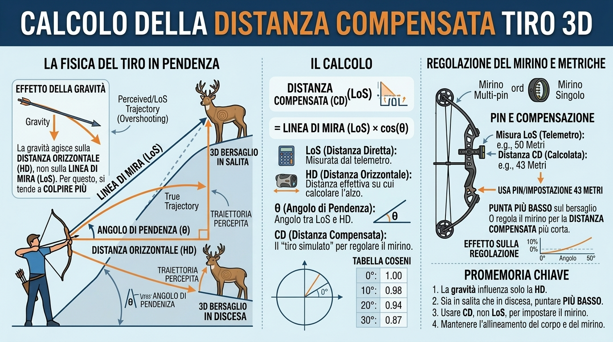

# Miraglio


**Miraglio** è un'app Android per arcieri che **stima la distanza del bersaglio con la
fotocamera del telefono** (modello pinhole + calibrazione focale), permette di
**verificare la misura camminando con il GPS** e di **salvare i luoghi** (foto +
misura + coordinate), condivisibili come pin Google Maps, QR code o foto georeferenziata.

> **📲 Installare l'app sul telefono** (guida per chi la usa, non per chi la sviluppa):
> [INSTALLAZIONE.md](INSTALLAZIONE.md) — download dalla release, conferma di Android,
> prima calibrazione. Dalla prossima release lo stesso testo è pubblicato anche
> nelle note di rilascio.
>
> **📖 Manuale d'uso (italiano):** [MANUALE.md](MANUALE.md) — calibrazione per il massimo
> della precisione, limiti per dispositivo, zoom e modalità d'uso.

---

## Funzionalità

### Misura con la fotocamera (modalità LINEE — è la schermata iniziale)
- **Pizzica per zoomare** sul bersaglio, premi **Scatta fermo immagine**
- **Due linee** (verde/blu) sui bordi del bersaglio: tap per riselezionare,
  striscia a **sinistra** per spostarle, a **destra** per allargarle/stringerle;
  la distanza si ricalcola in tempo reale
- **Altezza nota libera in cm** (nessun preset); lo **zoom compensa** la focale
  automaticamente
- Linee **orizzontali** = altezza (fy), **verticali** = larghezza (fx), con
  bottone per scambiare l'asse
- Modalità **ALTEZZA**: da distanza nota calcola la dimensione reale tra le linee
- **Inclinometro**: la distanza orizzontale è compensata con l'angolo di tiro (cos θ)
- **Blocco della rotazione** nella barra in alto — e sulla stessa preferenza in
  **Impostazioni**: bloccata di default (in verticale il telefono non gira
  mentre si mira), un tocco la libera e la scelta resta; vale solo dentro
  Miraglio, non è un'impostazione di sistema
- **Tacche di riferimento sul mirino** in **MOA** e in **pollici a 20 iarde**
  (`in/20yd`, come sono tarati i mirini): scala sul bordo sinistro con lo zero al
  centro, quanto vale una tacca e quanto copre il bersaglio (dimensione nota ×
  distanza stimata). Il passo non è fisso — a 1x 1 MOA è 0,35 px — quindi si
  allarga finché le tacche si vedono, e il valore è scritto accanto
- **In orizzontale i pannelli passano accanto all'immagine** invece che sotto:
  immagine a sinistra, risultato/linee e pulsanti a destra

### Riconoscimento bersagli (opzionale, YOLOv8n ONNX)
- Modello **`yolov8n_hybrid.onnx`** inclusa in `app/src/main/assets/models/`
- Classi: **paglione** (bersaglio circolare, default 130 cm) e **Targa 3D**
  (rettangolare, default 80 cm) con preset di dimensione
- Allo scatto i bersagli vengono riquadrati in verde e **le linee si agganciano
  da sole** agli estremi del bersaglio più grande
- **Spento di default** (Impostazioni → *Riconoscimento paglione*): il modello
  ONNX è lazy e non viene caricato in memoria se non serve; riconoscimento una
  sola volta al fermo immagine, zero inferenza sull'anteprima

### Verifica distanza (GPS)
- **Partenza → cammina → arrivo**: distanza con Haversine, percorso a piedi
  cumulato, accuratezza dei fix mostrata in tempo reale
- La partenza si blocca **solo su un fix satellitare di adesso** (entro ±10 m,
  confermato dal fix successivo): un fix vecchio o di rete come partenza
  sposterebbe il punto di partenza di decine di metri, inventando distanza
- Si misura solo col **provider satellitare**; i fix scadenti o vecchi non
  entrano né nel percorso né nella chiusura, e "FINO A QUI" resta spento
  finché non torna un fix di adesso
- Il **percorso a piedi** somma ogni spostamento plausibile (rumore da fermo,
  salti e buchi negli aggiornamenti esclusi dalle regole in
  `domain/location/MeasurementRules.kt`, coperte da test)
- **Errore stimato** (accuratezze dei due fix combinate in quadratura); oltre 5 m
  di incertezza l'app chiede conferma prima di chiudere la misura
- La misura in corso **sopravvive alla morte del processo** (se non è più
  recente di 15 minuti) e il GPS resta attivo in background per **10 minuti**,
  il tempo di raggiungere il punto finale

### Calibrazione focale
- Focale **teorica** (FOV diagonale 67°) finché non si calibra: utile come prima
  prova, può sbagliare anche del 30%
- **Calibrazione multipunto per lente**: fotografa un bersaglio di dimensione e
  distanza note, posiziona le linee H/V con la lente d'ingrandimento → fx/fy come
  media dei punti
- **Distanza dal GPS**: premi **Segna bersaglio** stando davanti all'oggetto e
  **Distanza GPS** da dove miri — il campo si compila da solo con la distanza
  fra i due punti e l'errore stimato (±), senza digitare nulla; il punto segnato
  resta salvato fra le sessioni
- **Ogni obiettivo** (1x, ultra-grandangolo, tele…) ha la **propria calibrazione**;
  una lente non calibrata ripiega sulla lente principale
- **Gestione dei punti**: la card dice quale lente stai calibrando, elenca i punti
  salvati lente per lente e li cancella con conferma — solo quelli della lente in
  corso, o quelli di tutte le lenti
- **Grafico dei punti** con unità sugli assi (m/yd e px): i punti fuori linea
  sono in rosso e il messaggio dice a **quali distanze rifare la misura**;
  lo scarto massimo mostra quanto è stretta la calibrazione anche quando
  nessun punto è rosso
- Le misure usano la focale calibrata **automaticamente**, zoom compreso
- **Scambio fra due telefoni** ("Condividi o importa"): la calibrazione parte come
  **testo** (messaggio, copia-incolla) o come **QR** da inquadrare. Prima di
  scrivere, l'app mostra da **quale marca e modello** arriva, quanti punti sono e
  su **quale lente** finiscono — le lenti si accoppiano per posizione, quelle che
  qui non esistono si saltano invece di appoggiarsi a un'altra lente. Una somma
  di controllo protegge il testo: un copia-incolla tagliato si rifiuta, non entra
  in silenzio
- Importare **sostituisce** la calibrazione di quella lente (sostituirsi è
  l'unica cosa sensata: la media fra due telefoni non vale per nessuno dei due)
- Dopo l'importazione la focale **si verifica misurando**: la prima misura di
  prova su un bersaglio noto viene confrontata col numero arrivato dal file, e
  oltre il **15%** di scarto l'app avvisa invece di lasciar credere che quei
  valori valgano su questo telefono

### Luoghi e condivisione
- **Salva** lo scatto (foto + misura + GPS + bersaglio stimato dalla bussola) o la
  misura GPS a piedi
- Elenco luoghi con **riepilogo, rinomina, eliminazione** e dettaglio completo
- **Note libere** sul luogo: oltre all'etichetta (che è solo un nome) un campo
  note per quello che dopo una settimana non ricordi — facciata nord, zoom usato,
  dubbi sulla distanza. Si salva con il pulsante e **non entra nella condivisione**
- **Anteprima della nota** nell'elenco dei luoghi, sotto l'etichetta: quello che
  si è scritto si rilegge senza aprire il dettaglio
- **Coordinate copiate con un tap lungo** sul dettaglio o direttamente
  nell'elenco: `lat, lon` (sei cifre, punto decimale, senza l'accuratezza)
  finiscono negli appunti pronti da incollare in un'altra app
- **Condivisione**: messaggio di testo con pin Google Maps (`https://maps.google.com/?q=lat,lon`,
  tappabile da Android e iPhone), **QR code** del link o del messaggio (ZXing),
  foto con banda di testo e **GPS nei metadati EXIF**
- Archivio **interamente offline**: foto JPEG + indice `index.json` nei file
  interni dell'app, nessun database e nessun server
- **Conferma con le mani**: quando il luogo (o un punto di calibrazione) è
  davvero salvato il telefono dà un **tocco breve** — si sa che è andata bene
  senza guardare lo schermo. Solo sull'esito positivo, e rispetta l'interruttore
  di sistema del feedback tattile

### Sensori e consumi
- **Bussola**: direzione di mira in gradi dal nord vero, con etichetta N/NE/E/…
- **Risparmio energetico**: in background sensori e GPS si spengono (tranne la
  finestra di grazia della misura GPS); tutto riparte al rientro in primo piano

### Lingua
- La lingua si sceglie **dentro l'app**: *Impostazioni → Lingua*, con **Come il
  telefono**, **Italiano**, **Español** o **Inglese**. Il cambio è immediato
- Cambia **tutto**: etichette, messaggi composti dalle ViewModel, testo che si
  condivide e anche **numeri e date** (virgola e `24/10/2026` in italiano, punto
  e `Oct 24, 2026` in inglese, `20,5 m` e `24 oct 2026` in spagnolo)
- Da Android 13 la stessa voce esiste anche in *Impostazioni → App → Miraglio →
  Lingua*: le due sono **la stessa preferenza**, non due scelte da tenere allineate
- Il ripiego resta l'inglese (`values/`): un telefono francese o tedesco che non
  ha mai toccato questa voce si apre in inglese
- Aggiungere una lingua è una cartella (`values-xx/`), una riga in
  `AppLanguageChoice` e una in `xml/locales_config.xml`: `AppLanguageTest`
  confronta le tre cose, e `StringsXmlTest` confronta **ogni** traduzione col
  ripiego, anche quella aggiunta a metà

### Unità di misura
- Il sistema di unità si sceglie **dentro l'app**: *Impostazioni → Unità di
  misura*, con **Metriche (m, cm)** o **Imperiali (yd, in, ft)**. Partenza:
  metriche, quindi chi aggiorna non trova i numeri cambiati
- È **indipendente dalla lingua**: un inglese può tirare in metri e un italiano a
  un campo in iarde. Cambiare lingua non tocca le unità, e viceversa
- Cambia **distanze** (iarde), **dimensioni dei bersagli** (pollici) e
  **incertezza** (piedi): un bersaglio a 30 m diventa «33 yd», un paglione alto
  1,22 m diventa «48 in», un'accuratezza GPS di ±5 m diventa «±16,4 ft»
- Dentro l'app **non cambia niente**: distanze, dimensioni e focale restano in
  metri e in pixel, quindi i luoghi salvati e le calibrazioni valgono identici
  nei due sistemi, e il cambio è solo di scrittura
- I campi dicono la loro unità e la seguono: «48» in pollici vale come «122» in
  centimetri, e cambiando sistema mentre la schermata è aperta il numero già
  scritto viene riscritto (`130` cm → `51,2` in): altrimenti la stessa cifra
  letta come pollici sarebbe un bersaglio 2,54 volte più grande

### Aggiornamenti dall'app (GitHub Releases)
- **Controllo silenzioso all'avvio** (senza rete non si vede niente) e voce
  **Aggiornamenti** in Impostazioni, con la versione installata e un bottone per
  controllare a mano
- Se c'è una versione più recente compare un dialog con le **note di rilascio**;
  l'APK si scarica **solo quando lo chiedi** e l'**installazione la conferma
  sempre Android** (l'app non installa niente da sola)
- L'APK scaricato è **firmato con la stessa chiave** di quello installato,
  quindi aggiornarsi **non cancella luoghi, foto e calibrazioni**
- Nel dialog dell'app le note sono **solo le novità**: la guida di installazione
  che apre la pagina della release viene tagliata al marcatore
  `<!-- fine-guida-installazione -->` (logica pura in `domain/update/ReleaseNotes.kt`,
  coperta da test)

### Installare Miraglio su un altro telefono
- In *Impostazioni* la card **Installa su un altro telefono** genera il **QR e il
  link della release più recente**: l'altro arciere inquadra il QR, si apre la
  pagina con le istruzioni e l'APK ([INSTALLAZIONE.md](INSTALLAZIONE.md))
- **Condividi** manda il messaggio con il link, **Condividi il QR come immagine**
  manda il QR come foto; il link resta visibile e copiabile nel dialog
- Il link è costruito dal repository degli aggiornamenti (`BuildConfig.UPDATE_REPO`)
  e punta a `/releases/latest`, quindi **non invecchia** con le versioni
- Il confronto fra versioni è **numerico**: `1.0.10` è più recente di `1.0.9`
  (un confronto fra testi direbbe il contrario)

---

## Come calcola la distanza



La fotocamera misura la **linea di vista** (LoS) verso il bersaglio, l'inclinometro
dà l'angolo θ e l'app riporta la misura sulla **distanza orizzontale**:
`CD = LoS × cos θ`, quello che in schermata leggi come *Distanza compensata*.
A 30° di pendenza il coseno vale 0,87, cioè la distanza grezza sbaglia del 13%:
è l'errore che fa credere di dover correggere il mirino. La parte sull'attrezzo
è riferimento generale, non una funzione dell'app — Miraglio misura la distanza,
il mirino lo regoli tu. Il ragionamento completo è in [MANUALE.md](MANUALE.md).

---

## Schermate

L'app si apre sulla schermata di **misura**; dal menu (☰) si raggiungono le altre:

| Schermata | Percorso |
|-----------|----------|
| Misura (LINEE) | iniziale |
| Verifica distanza | menu → *Verifica distanza* |
| Luoghi memorizzati | menu → *Luoghi memorizzati* |
| Dettaglio luogo | da elenco luoghi |
| Calibrazione focale | menu → *Calibrazione* |
| Impostazioni | menu → *Impostazioni* |

---

## Stack tecnico

| Layer | Tecnologia |
|-------|------------|
| UI | Jetpack Compose (Material 3, chiaro/scuro), Navigation Compose, PreviewView (CameraX) |
| DI | Hilt |
| Persistenza | SharedPreferences (calibrazione, impostazioni) + indice JSON dei luoghi + SavedStateHandle |
| Camera | CameraX 1.4 (ImageAnalysis + Preview), lenti multiple, zoom digitale |
| ML / Vision | ONNX Runtime (YOLOv8n), ML Kit Text Recognition |
| QR / Condivisione | ZXing (solo generazione), FileProvider, ExifInterface (GPS) |
| GPS / Sensori | LocationManager (misure solo dal provider satellitare), accelerometro/giroscopio, bussola |
| Formato display | Numeri, date e **lunghezze** nella lingua e nel sistema di unità scelti (`domain/format/DisplayFormat.kt`): virgola e gg/mm/aaaa in italiano, punto e *Oct 24, 2026* in inglese, `20,5 m` e *24 oct 2026* in spagnolo; metri e centimetri oppure iarde, pollici e piedi; ora sempre di Roma |
| Build | Gradle (Kotlin DSL), libs.versions.toml, AGP 8.7.3, Kotlin 2.1.0 |
| Min SDK | 26 (Android 8.0) — Target/Compile SDK 35 |
| Aggiornamenti | GitHub Releases REST API (`HttpURLConnection` + `org.json`), FileProvider → installatore di sistema |
| Release / CI | GitHub Actions (tag `v*.*.*` → APK firmato → release pubblicata con APK e `.sha256`) |
| Lingua | Si sceglie **dentro l'app** (Impostazioni → Lingua): come il telefono, italiano, spagnolo o inglese. Il ripiego è l'inglese (`values/`), le traduzioni stanno in `values-it/` e `values-es/`; `xml/locales_config.xml` dichiara le stesse lingue ad Android 13+. Cambio a caldo, senza riavviare l'app |
| Unità di misura | Si sceglie **dentro l'app** (Impostazioni → Unità di misura), **indipendente dalla lingua**: metriche (m, cm) o imperiali (yd, in, ft). Dentro l'app si continua a contare in metri (`UnitSystem.kt` + `DisplayFormat.kt`): la conversione esiste solo dove si scrive e dove si legge un numero |
| Test | JUnit 4 (JVM): confronto versioni, lettura release, invito, regole di misura, formattazione, parità delle traduzioni |

---

## Struttura del progetto

```
app/src/main/java/com/miraglio/
├── data/
│   ├── camera/        # CameraService, MiraglioAnalyzer (fotogramma latest), BitmapConverter
│   ├── focal/         # FocalCalibrationStore (punti fx/fy per lente)
│   ├── location/      # LocationTracker (GPS + network)
│   ├── ocr/           # OcrTextRecognizer (ML Kit) — presente ma mai chiamato
│   ├── places/        # PlacesRepository (foto + index.json), PlaceRecord
│   ├── sensor/        # Compass, Inclinometer
│   ├── session/       # ShotVerificationStore (stima vs misura)
│   ├── settings/      # AppSettingsStore (riconoscimento on/off)
│   ├── share/         # QrCodeRenderer (ZXing), ShareImageComposer (banda + EXIF GPS)
│   ├── update/        # GitHubReleasesClient, ApkDownloader, ApkInstaller, UpdateManager
│   └── vision/        # YoloObjectDetector (ONNX), NoOpObjectDetector
├── domain/
│   ├── camera/        # PinholeDistanceEstimator (d = K·f/pixel)
│   ├── format/        # DisplayFormat (numeri e date nella lingua scelta)
│   ├── location/      # GpsFix, Haversine, TargetEstimator (bersaglio stimato)
│   ├── share/         # ShareMessageComposer (messaggi con pin Maps)
│   ├── update/        # AppVersion, ReleaseInfo, ReleaseNotes (taglia la guida), InstallInvite
│   └── vision/        # ObjectDetector, DetectionBox, TargetScorer
├── di/                # Moduli Hilt (VisionModule, TextsModule)
├── i18n/              # AppLanguage (lingua scelta + contesto localizzato), Texts + AndroidTexts
├── power/             # BackgroundPowerController (sensori/GPS in background)
└── ui/
    ├── capture/       # Schermata misura (fermo immagine + linee + gesture)
    ├── measurement/   # Verifica distanza a piedi (GPS)
    ├── calibration/   # Elenco calibrazioni
    ├── focal/         # Scatto punti di calibrazione (linee + lente d'ingrandimento)
    ├── i18n/          # LocalDisplayFormat (numeri e date nella lingua corrente, per Compose)
    ├── places/        # Elenco + dettaglio luogo, barra Salva/Condividi/QR
    ├── settings/      # Impostazioni
    ├── navigation/    # NavHost (Capture, Measurement, Places, Calibration, …)
    ├── update/        # Dialog di aggiornamento (scaricamento + installazione)
    └── theme/         # Tema Material 3 (verde/arancio, chiaro/scuro)

app/src/main/assets/models/yolov8n_hybrid.onnx   # modello di riconoscimento (~12 MB)
app/src/main/res/drawable-nodpi/                  # icona dell'app (foto PNG, 432 px)
app/src/main/res/values/                          # stringhe in inglese (ripiego per ogni altra lingua)
app/src/main/res/values-it/                       # traduzione italiana
app/src/main/res/values-es/                       # traduzione spagnola
app/src/main/res/xml/locales_config.xml           # lingue dichiarate al sistema e al selettore in-app
app/src/test/java/com/miraglio/                   # test: aggiornamento, invito, regole di misura, lingua e formattazione
docs/img/                                         # banner, infografica e icona usate nei documenti
.github/workflows/release.yml                    # tag -> APK firmato -> release
```

---

## Stato corrente (v1.0.7, versionCode 8)

| Funzione | Stato |
|----------|-------|
| Misura LINEE (fermo immagine + linee + gesture) | ✅ Funzionante |
| Riconoscimento bersagli YOLOv8n (ONNX incluso) | ✅ Integrato (opt-in, test dispositivo in corso) |
| Calibrazione focale multipunto per lente | ✅ Funzionante |
| Compensazione inclinazione (distanza orizzontale) | ✅ Funzionante |
| Verifica distanza GPS (partenza→arrivo, errore stimato) | ✅ Funzionante |
| Luoghi: salva/elenca/rinomina/elimina, note libere, copia coordinate col tap lungo | ✅ Funzionante |
| Condivisione: messaggio + pin Maps + QR + foto con EXIF GPS | ✅ Funzionante |
| Aggiornamento dall'app (GitHub Releases) | ✅ Funzionante — **provato sul telefono** |
| Invito installazione (QR/link per un altro arciere) | ✅ Funzionante — **provato sul telefono** |
| Lingua (italiano / spagnolo / inglese) e formattazione coerente | ✅ Fatto — il selettore in-app (Impostazioni → Lingua) è nuovo: da provare sul telefono |
| Unità di misura (metriche / imperiali) | ✅ Fatto — scelta in Impostazioni, indipendente dalla lingua: da provare sul telefono |
| Blocco rotazione (barra in alto + Impostazioni, default: verticale) | ✅ Fatto — da provare sul telefono |
| Pannelli accanto all'immagine in orizzontale (mira e misura) | ✅ Fatto — da provare sul telefono |
| Tacche sul mirino in MOA e pollici a 20 iarde | ✅ Fatto — da provare sul telefono |
| Scambio calibrazione fra due telefoni (testo o QR) | ✅ Fatto — da provare su due telefoni dello stesso modello |
| Verifica della focale importata (bersaglio noto, scarto oltre il 15%) | ✅ Fatto — da provare sul telefono |
| Conferma aptica dei salvataggi | ✅ Fatto — da provare sul telefono |
| Test automatici | ✅ Coprono aggiornamento, invito installazione, regole di misura, formattazione e parità di ogni traduzione col ripiego |

Note oneste:
- La precisione senza calibrazione focale può essere peggiore del 30%: la guida
  completa in [MANUALE.md](MANUALE.md) spiega come calibrare.
- I dati di calibrazione valgono **per quel modello di telefono**: si possono
  mandare a un altro telefono (testo o QR), ma su un modello diverso sono numeri
  del telefono sbagliato — per questo l'app dice da dove arrivano **prima** di
  importarli.
- La distanza è soggetta al limite di 80 m del modello pinhole implementato.
- Il riconoscimento dei **testi** dei bersagli (ML Kit OCR) **non è usato**: il
  codice e la dipendenza restano nel progetto, ma nessuna schermata lo chiama.
  È in [Roadmap](#roadmap), non tra le funzioni.

---

## Compilazione

```bash
# Dalla root del progetto (Gradle arriva dal wrapper, non serve installarlo)
./gradlew assembleDebug     # APK di debug
./gradlew assembleRelease   # APK di release, firmato (quello degli aggiornamenti)
./gradlew check             # test + lint (lint con warningsAsErrors)
```

Output: `app/build/outputs/apk/debug/app-debug.apk` e
`app/build/outputs/apk/release/app-release.apk` (senza `keystore.properties` la
release esce **`app-release-unsigned.apk`**, che non si installa: vedi
*Firma dell'APK*).

### Requisiti
- JDK 17+
- Android SDK 35
- `local.properties` con `sdk.dir` (generato da Android Studio)

---

## Pubblicare una nuova versione

Il tag è la versione: da quella release la vostra app installata si accorge
dell'aggiornamento. Il workflow **rifiuta** la pubblicazione se tag e
`versionName` non coincidono, perché produrrebbe un APK che nessuno vede come
più recente.

Le istruzioni di installazione che finiscono nella release sono
[INSTALLAZIONE.md](INSTALLAZIONE.md): è l'**unica fonte**, quindi si correggono
solo lì (il workflow la usa come corpo delle note, seguito dal changelog
generato da GitHub). Il banner e l'infografica che contiene sono puntati a
`https://raw.githubusercontent.com/oraziog/miraglio/master/docs/img/...` e non
a percorsi relativi: il corpo della release non è un file del repository, e un
link relativo darebbe 404 proprio sulla pagina che deve installare l'app.

1. Alza **`versionCode`** e **`versionName`** in [app/build.gradle.kts](app/build.gradle.kts)
   (es. `versionCode = 8`, `versionName = "1.0.7"`).
2. Committa e spingi il tag:

```bash
git commit -am "Versione 1.0.7"
git tag v1.0.7
git push origin master v1.0.7
```

3. GitHub Actions compila, firma e pubblica la release con l'APK e il suo
   **`.sha256`** allegati
   ([.github/workflows/release.yml](.github/workflows/release.yml)): si segue
   in *Actions* su GitHub. Il checksum è anche scritto nel corpo della release e
   si verifica con `sha256sum -c miraglio-1.0.7.apk.sha256`.
4. Al primo avvio dopo la pubblicazione l'app installata avvisa che c'è la 1.0.7.

### Firma dell'APK

La firma è **l'identità dell'app**: Android accetta un aggiornamento solo se è
firmato con la stessa chiave del pacchetto installato, altrimenti prima va
disinstallata l'app (perdendo luoghi, foto e calibrazioni). Per questo la chiave
di rilascio è **dedicata** e custodita **fuori dal repository**, in
`%USERPROFILE%\.miraglio\miraglio-release.jks`. Prima era la chiave di debug
(della macchina di sviluppo, password `android`): chi la possedeva poteva firmare
un APK che il telefono avrebbe accettato come aggiornamento di Miraglio.

| Dove | Cosa |
|------|------|
| `keystore.properties` (radice, in `.gitignore`) | `storeFile`, `storePassword`, `keyAlias`, `keyPassword` — come si firma in locale |
| Segreti del repository | `KEYSTORE_B64` (il `.jks` in base64), `KEYSTORE_PASSWORD`, `KEY_ALIAS`, `KEY_PASSWORD` — il workflow li passa come variabili d'ambiente `KEYSTORE_PATH`, `KEYSTORE_PASSWORD`, `KEY_ALIAS`, `KEY_PASSWORD` |
| Impronta del certificato | `ce7eaa63…34250f73` (SHA-256): il workflow la controlla sull'APK appena compilato e **si ferma** se non combacia |

Password e chiave si copiano in un gestore di password (e il `.jks` anche fuori
dal computer): **se la chiave si perde, nessun telefono può più aggiornarsi**, e
ogni arciere deve disinstallare e reinstallare. L'impronta e la password sono
anche in `%USERPROFILE%\.miraglio\CHIAVE-FIRMA.txt`, da spostare lì.

Senza chiave configurata la release esce **non firmata**
(`app-release-unsigned.apk`): il ripiego sulla chiave di debug è stato tolto
apposta, perché un APK firmato con la chiave sbagliata si scoprirebbe solo al
primo aggiornamento fallito sui telefoni. Su una macchina nuova la chiave si
ricrea così (la password la chiede keytool: va scelta lunga e custodita):

```bash
keytool -genkeypair -keystore "$HOME/.miraglio/miraglio-release.jks" \
  -storetype PKCS12 -keyalg RSA -keysize 4096 -validity 10000 \
  -alias miraglio -dname "CN=Miraglio, O=Miraglio, C=IT"
```

> ⚠️ **Una volta sola, con il cambio di chiave**: le release fino alla 1.0.2
> erano firmate con la chiave di debug, quindi il **primo** aggiornamento dopo
> il cambio non si installa sopra: va disinstallato e reinstallato (i dati
> salvati si perdono). Dalla 1.0.3 in avanti la chiave non cambia più.

---

## Installazione (sviluppo)

> **Non sei uno sviluppatore?** La guida che cerchi è
> [INSTALLAZIONE.md](INSTALLAZIONE.md): installazione da GitHub direttamente dal
> telefono, senza ADB e senza compilare.

```bash
# Via ADB (device autorizzato)
adb install -r app/build/outputs/apk/debug/app-debug.apk
adb shell am start -n com.miraglio/.MainActivity
```

In alternativa i script `send_apk.cmd` / `send_apk.ps1` inviano al telefono
l'APK **piu' recente** fra debug e release, via [croc](https://getcroc.com),
mostrando un QR code col link di ricezione e dicendo quale dei due ha scelto.
Per forzare uno dei due: `send_apk.ps1 -Variante debug` (o `release`); con
`-Prova` si vede solo cosa invierebbe, senza inviare niente.

Una volta pubblicata, la release si può installare anche a mano (utile la prima
volta, o per rimediare a un'installazione andata male): l'APK è allegato alla
release più recente su <https://github.com/oraziog/miraglio/releases>.

```bash
adb install -r app/build/outputs/apk/release/app-release.apk
```

---

## Permessi richiesti

- `CAMERA` — anteprima e misura
- `ACCESS_FINE_LOCATION` / `ACCESS_COARSE_LOCATION` — posizione dello scatto, bersaglio stimato e verifica distanza
- `VIBRATE` — feedback aptici
- `INTERNET` — solo per chiedere a GitHub se c'è una versione nuova e scaricare l'APK; l'app per il resto funziona offline
- `REQUEST_INSTALL_PACKAGES` — per affidare l'APK scaricato all'installatore di sistema: l'app non installa niente da sola, chiede sempre conferma ad Android. Da Android 8 in poi l'utente deve anche autorizzare *Installa app sconosciute* per Miraglio (l'app apre la schermata giusta). **Nota:** è un permesso che Google Play concede solo ad app la cui funzione principale è gestire pacchetti, quindi un'app che si aggiorna da GitHub difficilmente passerebbe la revisione sul Play Store: la distribuzione qui è via GitHub Releases.

---

## Roadmap

- [ ] Test automatici (unit/UI) sui calcoli di distanza e condivisione
- [ ] Validazione sul campo della calibrazione contro distanze note
- [ ] Quantizzazione del modello ONNX (APK più leggera, inferenza più rapida)
- [ ] OCR dei testi dei bersagli: collegare il riconoscitore ML Kit al fermo
  immagine (oggi `recognize()` non viene mai chiamato), oppure togliere codice
  e dipendenza

---

## Licenza

Rilasciato sotto licenza **MIT** — vedi [LICENSE](LICENSE).

In breve: puoi usare, modificare e ridistribuire Miraglio (anche in prodotti
chiusi) a patto di conservare la nota di copyright e il testo della licenza.
Il software è fornito "così com'è", senza garanzie.

---

## Crediti

- **ONNX Runtime** — Microsoft
- **ML Kit Text Recognition** — Google
- **ZXing** — Google
- **CameraX / Compose / Hilt** — AndroidX / Google
- **Dati di addestramento** del modello YOLO: immagini sintetiche generate in-house +
  dataset `archeryxpert-score-detection` di Amrs Workspace
  ([Roboflow Universe](https://universe.roboflow.com/amrs-workspace-5ewyi/archeryxpert-score-detection),
  licenza **CC BY 4.0**); metodologia di riferimento *Archery-Xpert/Score-Detection* (MIT)

---

# English

> This is a short English summary of the project. The full documentation is in
> Italian, in the sections above.

## What it is

**Estimating target distance with the phone camera — for archers.**

Miraglio is an Android app that estimates how far a target is from a photo
(pinhole model plus per-lens focal calibration), lets you verify that estimate
by walking the distance with GPS, and saves places — photo, measurement and
coordinates — that you can share as a Google Maps pin, a QR code or a
geotagged photo.

Written in Kotlin with Jetpack Compose, **Android 8.0+ only, no iPhone**. The
interface language is picked in the app itself (*Settings → Language*): Italian,
Spanish or English, or the phone's language.

Units are a **separate choice** from the language (*Settings → Measurement
units*): metric (m, cm) or imperial (yd, in, ft). Distances, target sizes and
GPS errors follow it — a target at 30 m reads "33 yd" — while everything stored
and computed stays in metres, so saved places and calibrations are the same in
both systems.

## What it does

- **Measure with the camera (LINES mode).** Pinch to zoom on the target, freeze
  the frame, then put two lines on the target edges: the distance is recomputed
  live while you drag them. You type the real height in cm (no presets) and the
  app compensates the lens zoom by itself.
- **Rotation lock.** Portrait by default, so the phone does not spin while you
  aim: one tap in the top bar lets it rotate, and the choice sticks. It applies
  only inside Miraglio, it is not a system setting.
- **Hands-free confirmation.** Saving a place or a calibration point ends with a
  short vibration, so you know it worked without looking at the screen.
- **Tilt compensation.** The camera measures the line of sight, the inclinometer
  gives the angle θ and the app reports the **horizontal** distance,
  `CD = LoS × cos θ`, shown on screen as the *compensated distance*. At 30° of
  slope the cosine is 0.87, so the raw line-of-sight distance is off by 13%: it
  is what makes you think your sight needs adjusting.
- **Optional target recognition (YOLOv8n, ONNX).** A model ships inside the APK;
  it is off by default, runs once on the frozen frame and snaps the lines to the
  target outline.
- **GPS distance check.** Start, walk, arrive: Haversine distance, walked path
  and fix accuracy in real time; the measurement survives the process being
  killed for 15 minutes and the GPS stays on in the background for 10.
- **Places.** Save a shot (photo + measurement + coordinates + target estimated
  from the compass), then list, rename or delete it. The archive is completely
  offline: JPEG files plus an `index.json` in the app's internal storage, no
  database and no server.
- **Sharing.** A text message with a Google Maps pin, a QR code, or a photo with
  a caption band and the coordinates in the EXIF metadata.
- **Self-updating.** At startup the app quietly asks GitHub Releases whether a
  newer version exists; the APK is downloaded only when you ask for it, and
  Android always confirms the install. The APK is signed with the same key, so
  updating keeps places, photos and calibrations.
- **Invite another archer.** A Settings card generates the QR code and the link
  to the latest release, either as a message or as an image.

## What it does NOT do

Honesty, because reading it here beats finding out in the field:

- It does **not** set your sight. Miraglio measures the distance; the pin,
  elevation and sight marks are yours to adjust. (The infographic above is in
  Italian.)
- It does **not** work without focal calibration: without it the estimate can be
  off by **more than 30%**.
- It does **not** measure beyond **80 m** — the limit of the pinhole model
  implemented.
- It does **not** read the text printed on targets: the ML Kit OCR code is in
  the project, but no screen calls it.
- It does **not** run on iOS.
- It is **not** on the Play Store: releases are published on GitHub.
- It does **not** install anything by itself, and it does **not** send anything
  anywhere: no account, no telemetry, no server.

## Install

Download `miraglio-<version>.apk` from the
[latest release](https://github.com/oraziog/miraglio/releases/latest) **on the
phone**, not on a computer. Android asks twice: allow *install unknown apps*
for the app you opened the file from, then tap **Install**. A Play Protect
warning is normal for apps that do not come from the Play Store. The step by
step guide is [INSTALLAZIONE.md](INSTALLAZIONE.md), in Italian.

## Quick start

1. Install the APK as above and grant the camera permission.
2. **Calibrate first.** A tape measure and five minutes: without calibration the
   distance can be off by more than 30%. The app calibrates each lens
   separately, and the values stay on that phone.
3. Open the app: it starts on the measure screen. Pinch to zoom, freeze the
   frame, drag the two lines onto the target and read the distance.

## Privacy

- **Permissions:** camera, location (only while measuring or saving a place),
  vibrate, and network access used **only** to ask GitHub whether a newer
  version exists.
- **Nothing is uploaded.** Places, photos and calibrations stay in the app's
  internal storage on the phone.
- **`REQUEST_INSTALL_PACKAGES`** exists so the downloaded APK can be handed to
  Android's own installer: the app never installs anything silently.

## Build from source

Requires JDK 17+, Android SDK 35 and a `local.properties` pointing at the SDK:

```bash
git clone https://github.com/oraziog/miraglio.git
cd miraglio
./gradlew assembleDebug     # debug APK
./gradlew check             # tests + lint (lint warnings are errors)
```

Output: `app/build/outputs/apk/debug/app-debug.apk`. The release APK is signed
with a dedicated key kept **outside** the repository: without
`keystore.properties` the build produces an `app-release-unsigned.apk` that
will not install.

## License

MIT. See [LICENSE](LICENSE).

## Credits

- **ONNX Runtime** — Microsoft
- **ML Kit Text Recognition** — Google (a dependency, not wired to any screen)
- **ZXing** — Google
- **CameraX / Compose / Hilt** — AndroidX / Google
- **YOLO training data**: synthetic images generated in-house plus the
  `archeryxpert-score-detection` dataset by Amrs Workspace
  ([Roboflow Universe](https://universe.roboflow.com/amrs-workspace-5ewyi/archeryxpert-score-detection),
  **CC BY 4.0**); reference methodology *Archery-Xpert/Score-Detection* (MIT)
